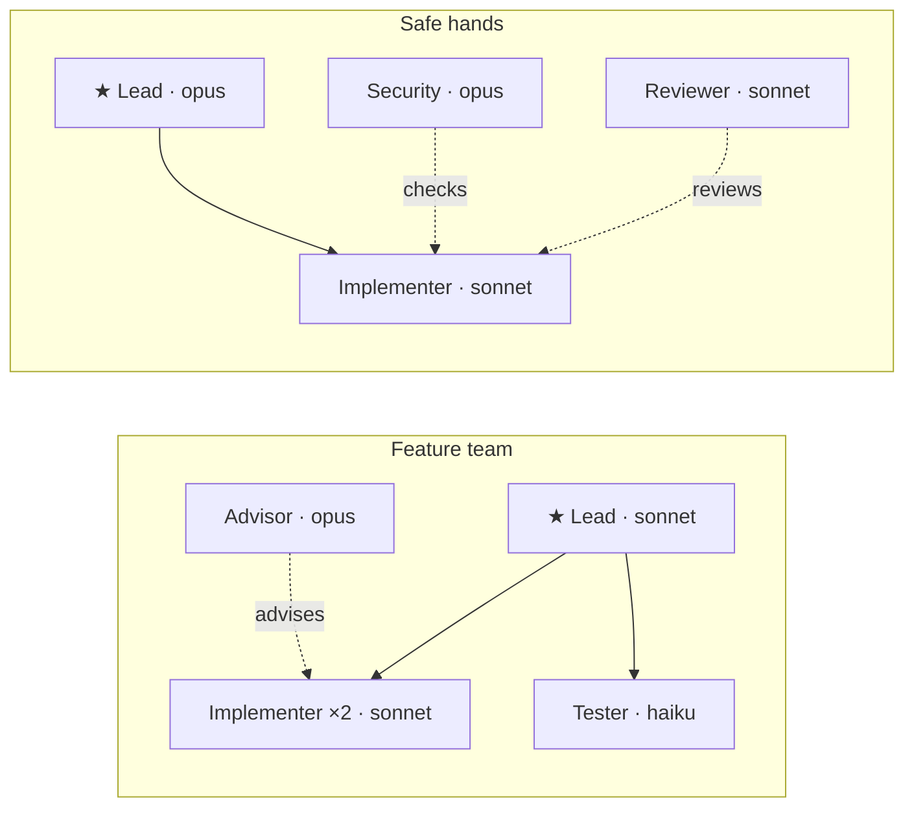
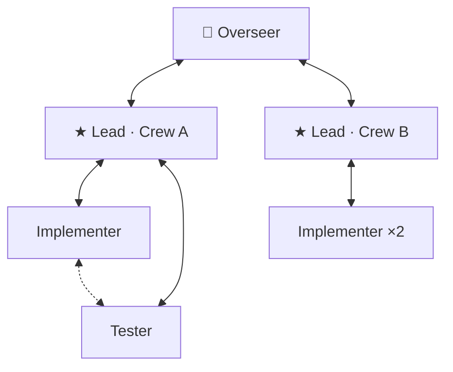

# Crewser

Run several Claude Code sessions as a team on one task.

- **Strategies**: choose how the crew is staffed (roles, models, who advises whom).
- **Communication**: sessions on a task can see and message each other.
- **Overseer**: one session above all crews coordinates across tasks.
- **Resume**: bring a finished task back, with every session continuing its own conversation.

## Install

```
/plugin install crewser --marketplace MadsLangkilde/crewser
```

Pick the **user** scope. Needs macOS with Terminal.app.

## Use

Run `/crew-task`, pick a task and a strategy, and the crew opens in tabs or windows.

| Command | |
|---|---|
| `/crew-task` | Start, resume, join or leave a task |
| `/crew` | See your crew, jump to or ping a member |
| `/crew-add` | Add members to a running crew |
| `/crew-stop` | Stop the crew and close its windows |
| `/crew-overseer` | Make this session the overseer |
| `/crew-strategy-new`, `-use`, `-config`, `-manage`, `-delete` | Create, use, change, browse or delete strategies |
| `/crew-town` | The town view (just for fun) |

## Strategies

A strategy defines the crew: roles, number of sessions per role, model per role, and who advises whom. Change one in plain words (*"add a security advisor on opus"*) or create one with `/crew-strategy-new`.

| Built in | Crew |
|---|---|
| **Duo** | Lead + implementer |
| **Feature team** | Lead, 2 implementers, tester, implementation advisor |
| **Safe hands** | Lead, implementer, security advisor, code reviewer |
| **Swarm** | Lead, 3 implementers, tester, architect |



Strategies are saved in `.crewser/strategies/` and shared through git.

## Communication and the overseer

Inside a crew, sessions message and ping each other. Across crews, the **overseer** talks to every lead: it asks for status, briefs, pauses or starts crews. Each extra crew works in its own git worktree, and you decide what gets merged.



## Resume

Every task keeps its crew, goal, status and history. In `/crew-task` → **Resume**, pick a task and the whole crew reopens in tabs or windows. Each session continues its own conversation.

## The town

Just for fun: `/crew-town` shows the crew as a pixel-art town, with buildings for features and people for sessions. Try `/crew-town demo`.

---

Full details: [docs/reference.md](docs/reference.md) · License: MIT
