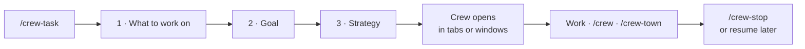
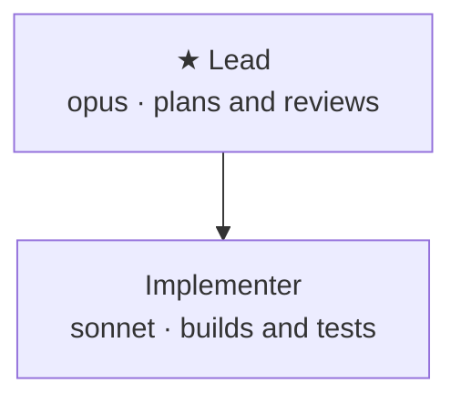
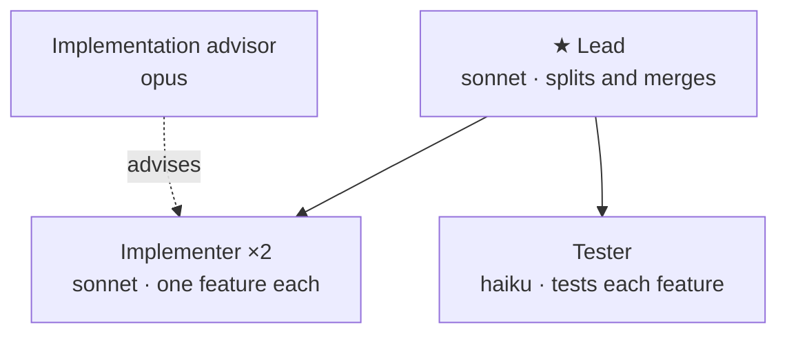
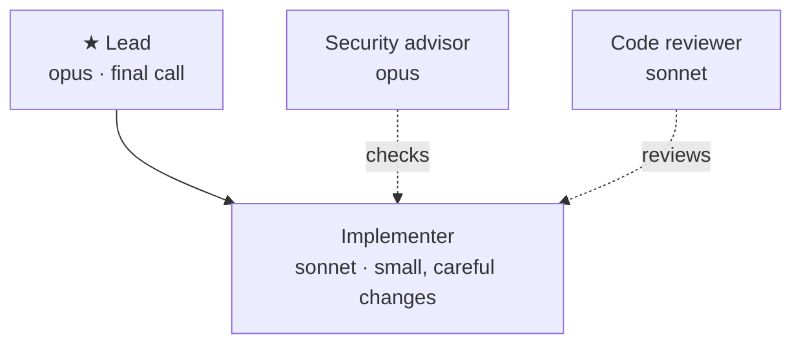
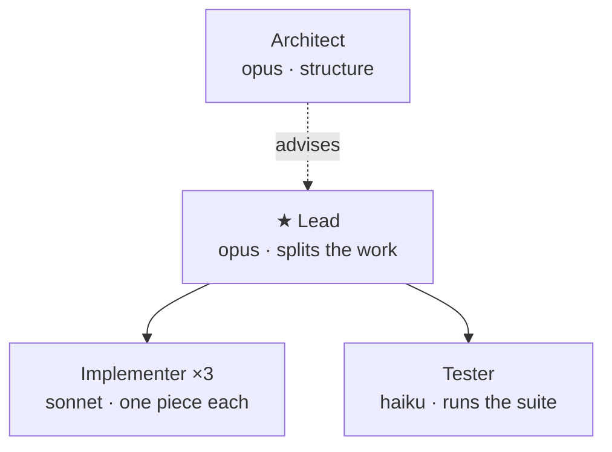
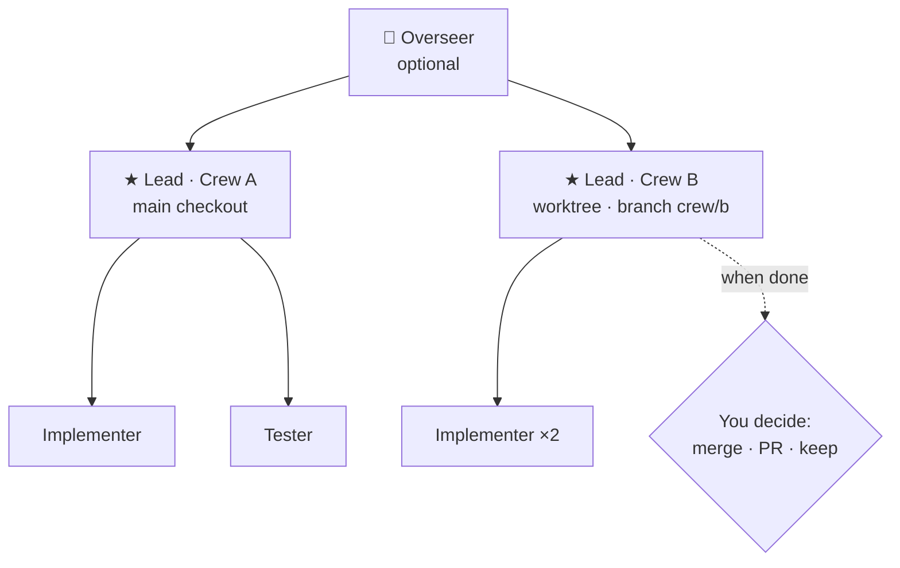

# Crewser

Run several Claude Code sessions as one team, a **crew**, working on the same task.

Each session gets a role (lead, implementer, tester, advisor…), its own model and its own Terminal window or tab. Sessions can see and ping each other, and you can watch the whole crew at work as a pixel-art town.

**Use it when** a task is too big or too risky for one session. For example, you might want several features built in parallel, a second model reviewing every change, or a tester running the suite after each merge.

## Install

```
/plugin install crewser --marketplace MadsLangkilde/crewser
```

Answer `y` to add the marketplace, then pick the **user** scope so it loads in every project.

Requirements: macOS with Terminal.app (for windows, tabs and pings). `/crew-town window` also needs Node.js.

## How to use it

1. Open Claude Code in your project and run `/crew-task`.
2. Pick **what to work on**. It suggests ideas from your recent commits and README, or you can type your own.
3. Confirm the **goal**.
4. Pick a **strategy**, meaning how the crew is staffed (see below). You can change it in plain words, like *"add a security advisor"*.
5. Choose **tabs** or **windows**. Every member opens in its own session and joins the task by itself.
6. Work with the lead as usual. Use `/crew` to see or ping members, and `/crew-town` to watch them.
7. When you're done, run `/crew-stop`, or just leave. A finished task can be resumed later from `/crew-task`.



## Commands

| Command | What it's for |
|---|---|
| `/crew-task` | Start, resume, join or leave a crew task. **Start here.** |
| `/crew` | See who's in your crew, jump to a member's window, or ping it |
| `/crew-add` | Add people to a running crew, e.g. *"one more tester"* or *"a UI expert on opus"* |
| `/crew-stop` | Stop the whole crew: all its sessions quit and their windows close |
| `/crew-tile` | Lay the crew's windows out in a grid again |
| `/crew-town` | Watch the crew as a pixel-art town and give members work. `window` opens it in a browser window, `demo` shows a demo crew |
| `/crew-overseer` | Make this session the boss of every crew in the project (`stop` to end it) |
| `/crew-strategy-use` | Start a task straight from a strategy |
| `/crew-strategy-new` | Describe a team in a sentence and get a strategy |
| `/crew-strategy-config` | Change a strategy: models, roles, how many sessions |
| `/crew-strategy-manage` | Browse all strategies as diagrams |
| `/crew-strategy-delete` | Delete a strategy |

You can also just ask Claude inside a task, e.g. *"which teammate is on the migration?"* or *"add a UI expert in its own session"*.

## Strategies

A strategy says which roles a crew has, how many sessions each role gets, which model each runs on, and who advises whom. Four templates come built in. Change any of them, or describe a new one with `/crew-strategy-new`.

Solid arrows show who hands work to whom. Dotted arrows show who advises whom; advisors review and answer but don't edit.

### Duo: one builder, one reviewer
A lead who plans and reviews, and an implementer who builds. Good for everyday tasks.



### Feature team: parallel features with a tester
The lead splits the task into features. Two implementers each build one, with an advisor on hand for design questions, and a tester checks each finished feature.



### Safe hands: quality first
One careful implementer, watched by a security advisor and a code reviewer. Nothing ships without both. Good for auth, payments and data changes.



### Swarm: many hands at once
Three implementers on independent pieces, an architect advising the lead on how to split the work, and a tester running the suite after every merge. Good for big, splittable work.



Strategies are saved in the project (`.crewser/strategies/`), so they're committed and shared with your team.

## Several crews and the overseer

Several crews can work on the same project at once, each on its own task. The second crew onward gets its own git worktree and branch, so crews never touch each other's files. When a crew finishes, **you** decide whether to merge, open a pull request or keep the branch.

`/crew-overseer` adds one session above all the leads. You tell it what you want across crews (*"search first, then checkout; pause a crew if tokens run low"*), and it messages, pauses and starts crews for you.



## The town

`/crew-town` draws the project as a pixel-art town. Every feature the crew builds becomes a building, and every session is a little person showing what it's doing: hammering while it edits, reading while it searches, fishing when idle. The gold in the **Tokens mine** shows how much of your 5-hour limit is left. Click a person to give it work.

The town is saved in the project (`.crewser/town/`), so it grows across tasks and merges with your teammates' towns. Try `/crew-town demo`.

## Usage bars

Every session shows bars under the prompt for context fill, the 5-hour limit and the weekly limit:

```
● Reviewer #1  ctx ███░ 58%  5h ██░ 31% ↻2h14  wk █░ 12%  ⚑ task #4821·role  👥 3
```

## Settings

Run `/config` (or `/plugin configure crewser@crewser`) to choose which bars show and their style, session colors, ping flashes and notifications, where strategies and the town are stored, and town options.

## More

[docs/reference.md](docs/reference.md) has every detail: the crew board, resuming tasks, tabs vs windows, the overseer's tools, how towns merge, and all settings.

## License

MIT
